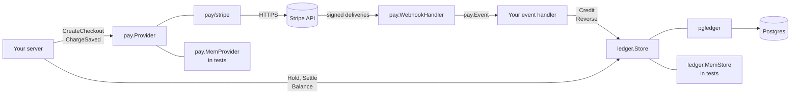

# pay

**pay is a Go module for selling credit, keeping a balance, and spending
it.** It has two halves that work together or apart: a payment port that
takes money through a processor such as Stripe without wiring the
processor into your product, and a credit ledger whose balances are
summed from an append-only history instead of stored. It includes a
webhook handler with fixed status codes, holds that stop concurrent
requests from spending the same money, and settlement that happens
exactly once.

[](https://github.com/latere-ai/pay/actions/workflows/ci.yml)
[](https://pkg.go.dev/latere.ai/x/pay)

## Status

The module is before v1.0.0, and the API can still change where the
design turns out wrong. A breaking change gets a minor version bump, and
the section of each release in the [changelog](CHANGELOG.md) names it.
The [releases page](https://github.com/latere-ai/pay/releases) lists the
releases. Latere's own products use it. The module has had no external
security audit; [`SECURITY.md`](SECURITY.md#what-is-protected) gives
what it protects, and the test that checks each property.

| Part | State |
|---|---|
| `money`: integer amounts in micro-USD, USD and EUR, rounding, the spread a seller keeps | Works |
| `pay`: the processor port, `WebhookHandler`, and `MemProvider`, a processor fake for tests | Works |
| `stripe`: hosted Checkout, saved customers, off-session charges with 3-D Secure, and six webhook events | Works, in USD only. Tested against a stub of the Stripe API; no test calls Stripe |
| `ledger`: credits, debits, holds, transfers, settlement, reversals, and an in-memory store | Works |
| `pgledger`: the Postgres store, and holds that commit in your own transaction | Works. Tested against Postgres 17 |
| `paytest` and `ledgertest`: conformance suites for your own adapter or store | Works |
| Refunds and disputes | A refund or a dispute reverses the whole credit, once. Partial refunds and a won dispute are not modeled |
| Holds | A hold lasts until its group is settled. There is no expiry; settle with a cost of 0 to release one |
| PayPal and Paddle | Named in the vocabulary, with no adapter |
| Subscriptions, a billing portal, saving a card without a charge | Not built |

## Quickstart

You need Go 1.27 or later. The program below sells $20 of credit through
the processor fake, credits it from a webhook that is delivered twice,
holds $5 for a job, and settles the job at $3.25. It needs no network
beyond the module download, no processor account and no database.

```sh
mkdir pay-quickstart && cd pay-quickstart
go mod init quickstart
cat > main.go <<'GO'
// Command quickstart sells $20 of credit, credits it from a webhook
// delivered twice, and spends part of it, with no processor account and
// no database.
package main

import (
	"bytes"
	"context"
	"fmt"
	"log"
	"net/http"
	"net/http/httptest"
	"strconv"

	"latere.ai/x/pay"
	"latere.ai/x/pay/ledger"
	"latere.ai/x/pay/money"
)

func main() {
	ctx := context.Background()

	// A processor fake and an in-memory ledger: no Stripe key, no database.
	processor := &pay.MemProvider{Secret: "shh"}
	book := ledger.NewMemStore()
	wallet := ledger.NewHolder("user", "ada@example.com")

	show := func(label string) {
		bal, err := book.Balance(ctx, wallet)
		if err != nil {
			log.Fatal(err)
		}
		avail, err := book.Available(ctx, wallet)
		if err != nil {
			log.Fatal(err)
		}
		fmt.Printf("%-28s balance %-8s available %s\n", label, bal.String(money.USD), avail.String(money.USD))
	}

	// 1. Sell $20 of credit. The cut is decided before the redirect and carried
	// on the session, so the webhook credits exactly what was quoted.
	spread := money.Spread{Bps: 500, FixedMicro: 30 * money.Cent} // 5% + $0.30
	gross := 20 * money.Dollar
	credited := spread.Credited(gross)
	out, err := processor.CreateCheckout(ctx, pay.CheckoutParams{
		Email:      "ada@example.com",
		Amount:     gross,
		Currency:   money.USD,
		SuccessURL: "https://example.com/wallet?ok=1",
		CancelURL:  "https://example.com/wallet",
		Meta: map[string]string{
			"holder":   string(wallet),
			"credited": strconv.FormatInt(int64(credited), 10),
		},
	})
	if err != nil {
		log.Fatal(err)
	}
	fmt.Println("checkout:", out.URL, out.SessionID)
	fmt.Println("charged:", gross.String(money.USD), "credited:", credited.String(money.USD))

	// 2. The webhook: credit the wallet on a verified, paid delivery.
	webhook := pay.WebhookHandler(processor, func(ctx context.Context, e pay.Event) error {
		if e.Kind != pay.KindPaid {
			return nil
		}
		amount, err := strconv.ParseInt(e.Meta["credited"], 10, 64)
		if err != nil {
			return nil // not one of ours; retrying will not help
		}
		return book.Credit(ctx, ledger.Posting{
			Holder: ledger.Holder(e.Meta["holder"]),
			Amount: money.Micro(amount),
			Reason: "topup",
			Ref:    e.Ref, // idempotent: a replay credits once
			Actor:  "memory:" + e.Ref,
		})
	})
	body := pay.MemEvent(pay.KindPaid, "pi_1", gross, processor.Checkouts()[0].Meta)
	for i := 1; i <= 2; i++ { // the second delivery is a replay
		req := httptest.NewRequest(http.MethodPost, "/webhooks/pay", bytes.NewReader(body))
		req.Header.Set(pay.MemHeader, "shh")
		rec := httptest.NewRecorder()
		webhook.ServeHTTP(rec, req)
		fmt.Printf("webhook delivery %d: HTTP %d\n", i, rec.Code)
	}
	show("after two deliveries:")

	// 3. Hold $5 for a job, so a burst of requests cannot spend the same money.
	if err := book.Hold(ctx, ledger.Posting{Holder: wallet, Amount: 5 * money.Dollar, Group: "job-1", Reason: "session"}); err != nil {
		log.Fatal(err)
	}
	show("after holding $5.00:")

	// 4. The job cost $3.25. Settle releases the hold and charges the cost, once.
	settled, err := book.Settle(ctx, ledger.Settlement{Holder: wallet, Group: "job-1", Cost: 3*money.Dollar + 25*money.Cent, Reason: "session"})
	if err != nil {
		log.Fatal(err)
	}
	fmt.Println("settled:", settled)
	again, err := book.Settle(ctx, ledger.Settlement{Holder: wallet, Group: "job-1", Cost: 3*money.Dollar + 25*money.Cent, Reason: "session"})
	if err != nil {
		log.Fatal(err)
	}
	fmt.Println("settled again:", again)
	show("after settling $3.25:")

	entries, err := book.Entries(ctx, wallet, ledger.Page{})
	if err != nil {
		log.Fatal(err)
	}
	for _, e := range entries {
		fmt.Printf("  %-8s %10s  %s\n", e.Kind, e.Amount.String(money.USD), e.Reason)
	}
}
GO
go get latere.ai/x/pay@latest
go mod tidy
go run .
```

It prints:

```text
checkout: https://pay.test/checkout cs_1
charged: $20.00 credited: $18.70
webhook delivery 1: HTTP 200
webhook delivery 2: HTTP 200
after two deliveries:        balance $18.70   available $18.70
after holding $5.00:         balance $18.70   available $13.70
settled: true
settled again: false
after settling $3.25:        balance $15.45   available $15.45
  debit        -$3.25  session
  release       $5.00  session
  hold         -$5.00  session
  credit       $18.70  topup
```

The second delivery credits nothing, because the credit is keyed on the
purchase's reference. The second settlement writes nothing, because a
group settles once.

## With Stripe and Postgres

Against a real processor and a real database, the quickstart builds its
processor and its ledger differently, and your server mounts the webhook.
`onEvent` is the function the quickstart passes to `pay.WebhookHandler`:

```go
processor := stripe.New(stripe.Config{
    SecretKey:     os.Getenv("STRIPE_SECRET_KEY"),
    WebhookSecret: os.Getenv("STRIPE_WEBHOOK_SECRET"),
})
book := pgledger.New(pool) // after pgledger.Migrate(ctx, pool)

mux.Handle("POST /webhooks/stripe", pay.WebhookHandler(processor, onEvent,
    pay.WithLogger(slog.Default())))
```

[Getting started](docs/getting-started.md) walks through each step, and
[Running Stripe](docs/stripe-operations.md) through the account
settings that change what a customer is charged.

## How it fits



- **Your server** opens a checkout or charges a saved card through
  `pay.Provider`, and never names the processor anywhere else.
- **`pay/stripe`** is the adapter for Stripe. `pay.MemProvider` stands in
  for it in tests, and `paytest` checks an adapter you write.
- **`pay.WebhookHandler`** verifies each delivery through the adapter,
  reduces it to one `pay.Event`, and answers with the status code that
  makes the processor retry only when a retry can help.
- **Your event handler** turns a paid event into a `Credit` and a refund
  or a dispute into a `Reverse`.
- **`ledger.Store`** holds the balances. `pgledger` keeps them in your
  Postgres database, `ledger.MemStore` keeps them in memory, and
  `ledgertest` checks a store you write.
- **`money`** is the amount type every package uses.

## Design in one paragraph

Amounts are `int64` micro-USD, never floats. A write API takes an
unsigned magnitude and applies the sign itself, so a caller cannot turn
a debit into a credit by passing a negative. A balance is `SUM(amount)`
over an append-only table, so it cannot disagree with its own history;
a mistake is corrected by another entry, never by an update. Holds are
left out of a balance and subtracted from what is *available*, which is
what stops two concurrent requests spending the same money. Every write
that an outside system can replay is idempotent on that system's
reference.

## Testing your integration

Your money path is testable with no processor and no database, as the
quickstart shows.

- `ledger.NewMemStore()` is a complete ledger in memory. It passes the
  same contract suite as the Postgres store.
- `pay.MemProvider` is a complete processor fake. It records every
  checkout and charge and accepts deliveries built with `pay.MemEvent`,
  so a test drives a purchase, its credit and its refund end to end.

If you write your own processor adapter or ledger store, run the
exported conformance suite against it: `paytest.RunProviderContract`
for an adapter, `ledgertest.RunStoreContract` for a store. Both stores
and the Stripe adapter in this repository pass the same suites. Before
any product used the Postgres store, the store suite found three bugs
in it and one piece of validation duplicated across the two stores.

## Documentation

| Page | What you find there |
|---|---|
| [Getting started](docs/getting-started.md) | Selling credit and spending it, end to end, and testing it offline |
| [The money model](docs/money-model.md) | Why a balance is a sum, what a hold is for, and how idempotency works |
| [Webhooks](docs/webhooks.md) | The delivery contract, the status codes, and what each event means |
| [Writing an adapter](docs/adapters.md) | Supporting a processor this module does not |
| [Running Stripe](docs/stripe-operations.md) | The account settings, the events to subscribe to, and recovery |
| [API reference](https://pkg.go.dev/latere.ai/x/pay) | Every package, type and function |
| [Design record](specs/README.md) | The approaches that were tried, and the ones rejected |

## Contributing

Issues and pull requests are welcome. [`CONTRIBUTING.md`](CONTRIBUTING.md)
covers building and testing a change, including the Postgres half of the
suite and the coverage floor. Do not report a vulnerability in an issue;
[`SECURITY.md`](SECURITY.md) says where to send it.

## License

[MIT](LICENSE)
